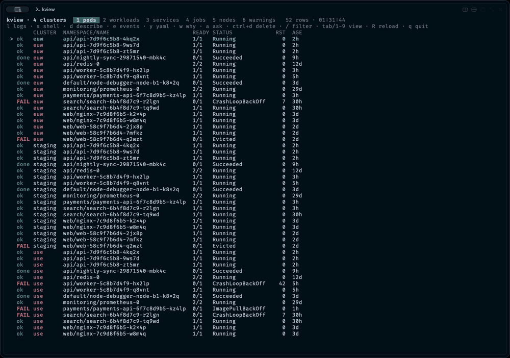
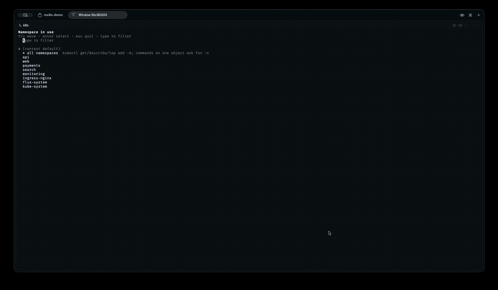
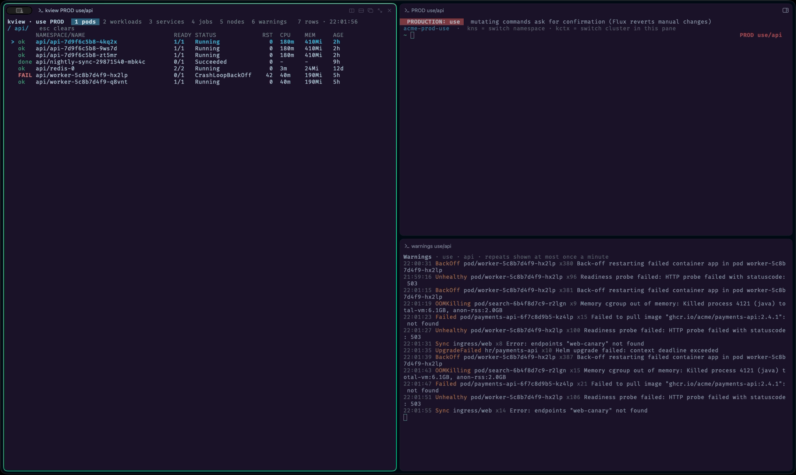
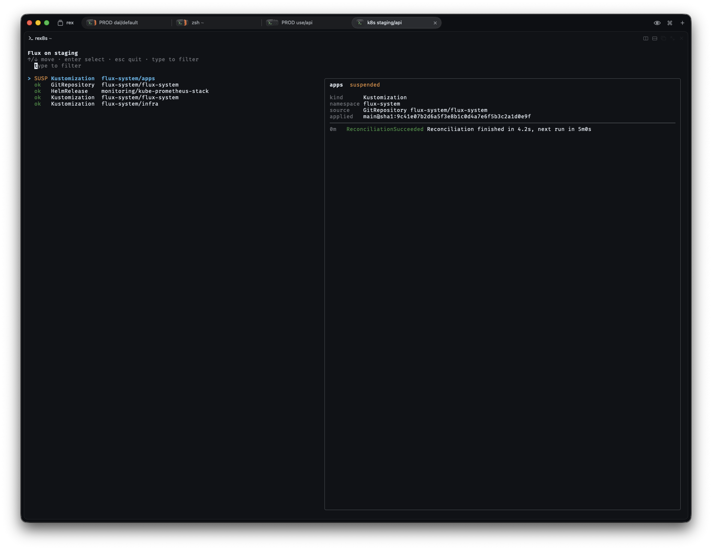
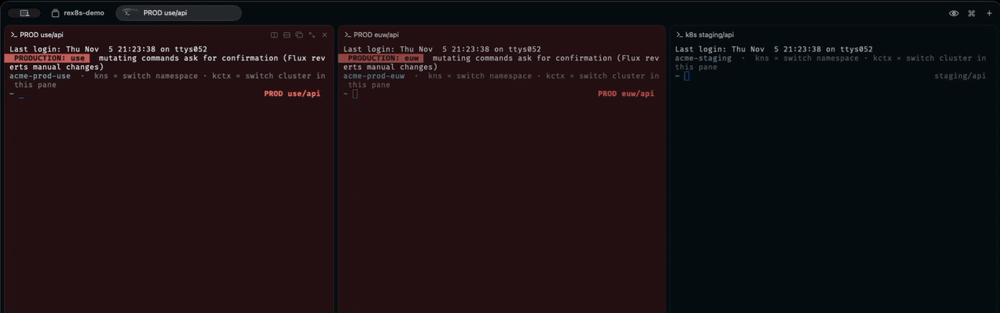
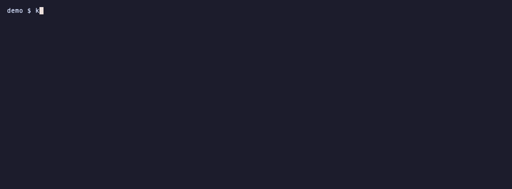
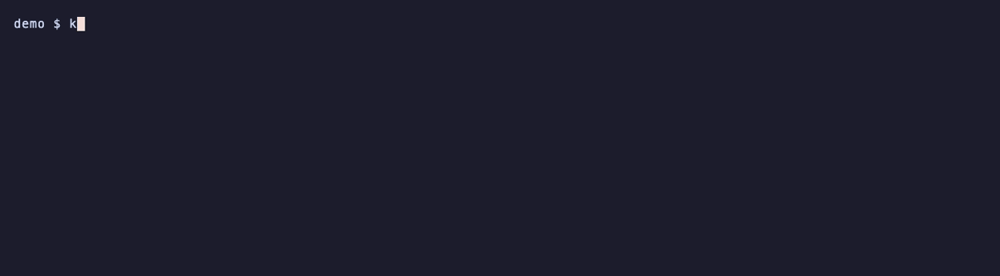
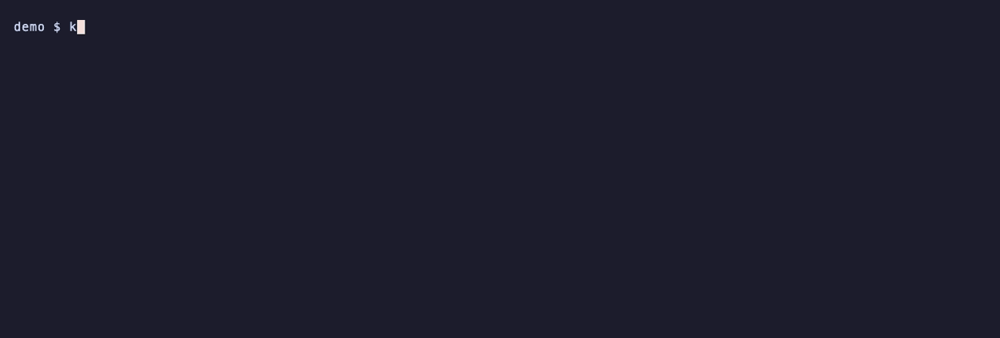
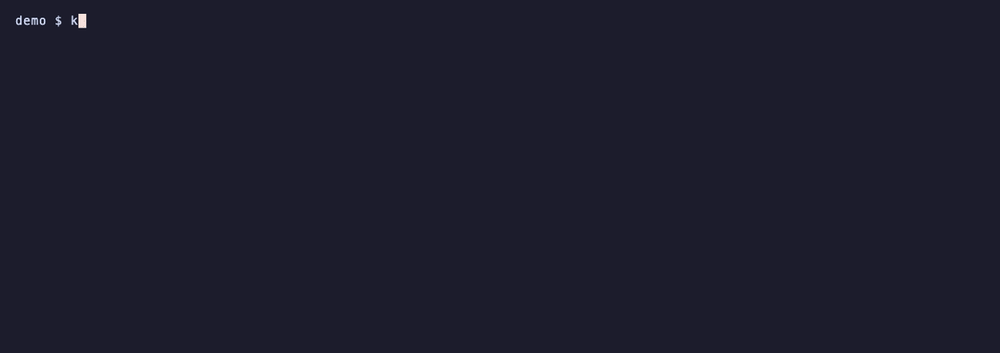
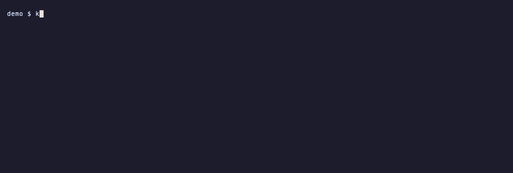

# rex8s

A Kubernetes toolkit for the [Rex](https://www.superlogical.com/rex) terminal:
isolated cluster panes, multi-cluster views, Flux (GitOps), a production guard
and Claude.



## Quick start

With [Rex](https://www.superlogical.com/rex) and `kubectl` set up:

```sh
brew install vitalbh/tap/rex8s && rex8s setup    # setup installs it into Rex
rex8s doctor                                     # checks everything
```

Then **⇧⌘J** in Rex: pick a cluster, get a shell on it. Don't remember a
command? **`khelp`** lists every one in a picker; enter runs it.

Without Homebrew, from source, or on a Linux server: [Install](docs/install.md).

## What it does

Every pane is **one cluster**: its own context and namespace, a label that
says where you are (`PROD use/api`), production tinted red, and a guard that
asks before `kubectl`/`helm`/`flux` change production — also when an agent or
a script runs them.

| You want to… | Commands |
|---|---|
| **browse like k9s** | `kview` tabs for pods, workloads, services, jobs, nodes, warnings — live lists, a key per action (`-A`: every cluster) |
| **see what's broken** | `kstatus` one screen of health · `kfail` failing pods with their last logs · `kpods` every cluster's pods · `kwarn -A` warnings of every cluster, live |
| **read logs** | `klogs` a workload's pods in one stream (`-A`: mix pods and workloads of any cluster) · `kgrep` search them · cluster URLs in the logs are clickable |
| **ask why** | `kwhy` Claude explains an unhealthy pod · `kask` a Claude conversation about the cluster or a pod · `kincident` a session laid out for an incident |
| **reach a service** | `kpf` port-forward that connects only while in use, with the right client command for databases · `kexec` / `knode` / `knet` shells in a pod, a node, a toolbox pod |
| **ship with Flux** | `fdiff` what your branch would change · `fwatch` follow a push until it rolled out · `kgit` the file that defines a workload · `kflux` reconcile, suspend |
| **work across clusters** | `kmulti` clusters side by side, `kall` types in all · `kwhat` what changed · `kver` which version runs where · `kdiff` · `krun` · `kroll` · `kcron` · `kjunk` |
| **keep an eye on things** | Raycast menu bars: Flux status, failing pods, alerts, default context |

Every command, with its options: **[docs/commands.md](docs/commands.md)**.

**⇧⌘J** picks a cluster for an isolated shell, **⇧⌘M** puts several side by side and `kall` types in all of them; **⇧⌘V** opens `kview` (above) on every cluster



<details>
<summary><b>See it</b> — recordings of each command</summary>

| Production tab (⇧⌘K): browser · shell · warnings, tinted red | `kflux` on a staging tab |
|---|---|
|  |  |

**`kmulti`** (⇧⌘M): clusters side by side — `kall` types the same command in all of them



| `kview`: tabs, a filter, describe, a workload's pods, jobs, warnings, nodes | |
|---|---|
|  | |
| **`kpods`**: the pods of every cluster, failing first | **`kpf`**: port-forward in the background, the client command for databases |
|  |  |
| **`fwatch`**: follow a commit until it's applied and rolled out | **`kwhy`**: ask Claude why a pod is unhealthy |
|  |  |
| **`kflux`**: Flux resources, failing first | **`kwarn -A`**: the Warning events of every cluster, live |
|  |  |
| **`kfail`**: failing pods with the crashed container's last logs | **`kjobs`**: Jobs and CronJobs with logs and recent runs |
|  |  |
| **`kstatus`**: the cluster's health on one screen | **`krun`**: one command, every pod, several clusters |
|  |  |
| **`kver`**: which version runs on which cluster | **`kdiff`**: the same workload on two clusters |
|  |  |
| **`kroll`**: restart workloads and follow the rollouts | **`knode`**: a shell on a node |
|  |  |
| **`kask`**: talk to Claude about the cluster or a pod | **`kwhat`**: what changed, on every cluster |
|  |  |
| **`klogs`**: a workload's pods in one stream | **`knet`**: network tools inside the namespace |
|  |  |
| **`kgrep`**: search a workload's logs, matches highlighted | **`kgit`**: from a workload to the file that defines it |
|  |  |
| **`kdisk`**: how full the volumes are | **`kreq`**: requests and limits vs real usage |
|  |  |
| **`kcron`**: CronJob runs coming up on every cluster | **`kjunk`**: leftovers to clean up |
|  |  |
| **`khelp`**: every command, enter runs it | **`ktint`**: pick the production color |
|  |  |
| **Cluster picker** (⇧⌘J): a live preview of each cluster | |
|  | |

All recordings use the built-in demo mode (fake `example.com` clusters) — see
[Development](docs/development.md#demo-mode).

</details>

## Documentation

- **[Commands](docs/commands.md)** — every command and key binding
- **[Install](docs/install.md)** — Homebrew, release, source, Linux servers, coding agents
- **[Configuration](docs/configuration.md)** — `config.yaml`, the `k*` commands in any shell, integrations
- **[Raycast](docs/raycast.md)** — the extension and its menu bars
- **[Development](docs/development.md)** — how it works, demo mode, known limitations

## License

[MIT](LICENSE)
