# rex8s

One Kubernetes cluster per pane in the [Rex](https://www.superlogical.com/rex) terminal,
with Flux (GitOps) built in.

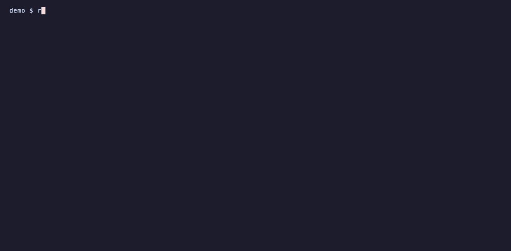

**Panes**

- **Fuzzy picker** (Bubble Tea) with a live preview of each cluster: namespace
  count and Flux status (ready, failing, suspended, with the error message).
- **Isolated panes**: each pane has its own context and namespace. Switching in
  one pane (`kctx`, `kns`) doesn't affect the others or `~/.kube/config`.
- **Pane and tab labels** always show where you are: `PROD use/api`, `k8s staging/default`.
- **Production panes are tinted red**, so you can tell them apart at a glance.
- **Production guard**: `kubectl`/`helm`/`flux` commands that mutate state, and
  `kexec` into a pod, ask you to type the cluster name first. Production is
  detected by server URL, so every alias of the same cluster is covered.
- **Expired logins** show up as "login expired" everywhere; picking such a
  cluster takes you straight to `kauth`.
- **Tabs come back** after the Rex server restarts: the picker offers to restore them.

**Flux / GitOps**

- **`fdiff`**: before you merge, preview what your working tree would change on
  each cluster (`flux diff kustomization`). Warns when your branch is behind.
- **`fwatch`**: after you push or merge, follows the change until Flux fetched
  it, every Kustomization applied it, and the Deployments/StatefulSets/
  DaemonSets (and HelmReleases) it changed finished rolling out. Progress shows
  in the Rex tab header; a notification at the end. Works with forks, merge
  commits, squash and rebase merges.
- **Flux monitor**: a dashboard of every cluster with notifications when
  something starts failing or recovers; the tab name is the health summary.
- **`kflux`**: pick a Flux resource (failing first) with its events, then
  reconcile and wait, describe, or suspend/resume.

**Debugging**

- **`kwhy`**: pick a pod and ask Claude why it is unhealthy (describe with env
  values redacted, events, current and previous logs; tools disabled).
- **`kask`**: a Claude Code conversation in a split, already holding the
  context. The picker's first row is the whole cluster (kstatus, broken pods
  with their last logs, the last hour's warnings); below it every pod, broken
  first (describe with env values redacted, events, logs). `kubectl logs x |
  kask` sends whatever you pipe in. Claude can run read-only `kubectl`/`flux` commands on
  its own to dig further; anything else asks for your approval, and on
  production the guard refuses changes unless re-run with `REX8S_FORCE=1` (a
  second approval). The context is saved in `~/.cache/rex8s/dumps/`;
  `kask --dump` only saves it and prints the path. Logs are sent as they are:
  they may hold sensitive data.
- **`kstatus`**: the cluster's health on one screen — nodes (pressure, CPU/memory),
  pods, unavailable workloads, Flux, failed jobs, firing alerts (from an
  Alertmanager or Prometheus inside the cluster, when there is one), expiring
  certificates (cert-manager) and the last hour's warnings. `-w` refreshes.
- **`kjobs`**: Jobs and CronJobs, failed first, with logs and recent runs in the
  preview; run a CronJob now, rerun, suspend/resume, delete.
- **`kfail`**: only the unhealthy pods of the cluster, with their recent events and
  last log lines in the preview — the crashed container's logs when it restarted.
  Logs are fetched only for the pod under the cursor.
- **`kwarn`**: only Warning events (OOMKilled, BackOff, probes, image pulls),
  deduplicated. Also the bottom pane of the k9s layout.
- **`krun`**: run a command in every pod of workloads on several clusters at
  once. `krun` opens a picker with every Deployment, StatefulSet and DaemonSet
  of every cluster (names may differ per cluster): type to filter, mark with
  space (ctrl+a marks all shown) or just press enter for one, then type the
  command. `krun nginx -- nginx -s reload` skips the questions when only one
  workload matches. Production asks once, with a y/N.
- **`klogs`**, **`kexec`**, **`kpf`**: pick a pod or service and follow logs,
  open a shell in it, or port-forward it — in a split next to your shell.
  `kpf -l` lists the running port-forwards: open, copy the URL or stop one
  (they also show in the Kube Context menu bar).
- **`knode`**: pick a node and get a shell on it in a split (`kubectl debug
  node`, the node's filesystem at `/host`). The debug pod is removed when you
  exit. Production asks first.

**Across clusters**

- **`kver`**: which version runs where — the image tag of every workload, one
  column per cluster. Rows that differ come first and are highlighted; `-d`
  shows only those.
- **`kdiff`**: compare a workload's spec between two clusters (YAML, without
  status and the fields the API server fills in). Pick one row and it finds the
  same name on the other cluster, or mark two rows.
- **`kroll`**: restart the workloads you mark (same picker as `krun`) and follow
  each rollout until it is done, with progress in the tab header. Production
  asks once, with a y/N.

### See it

| Production tab: k9s · shell · warnings, tinted red | `kflux` on a staging tab |
|---|---|
| 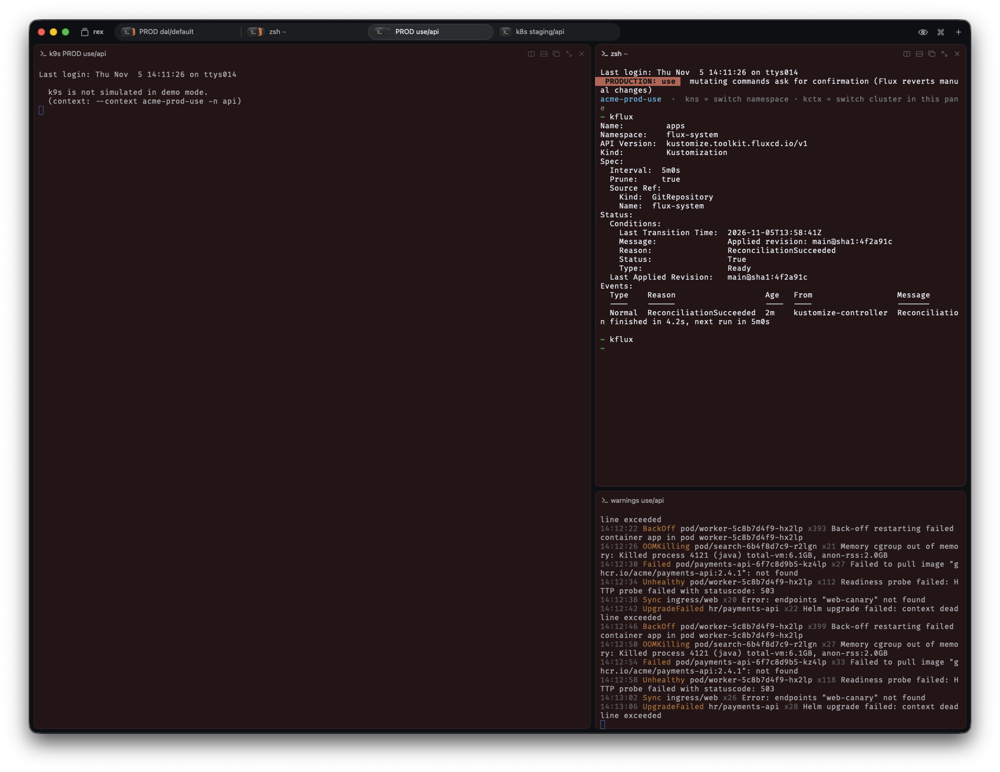 | 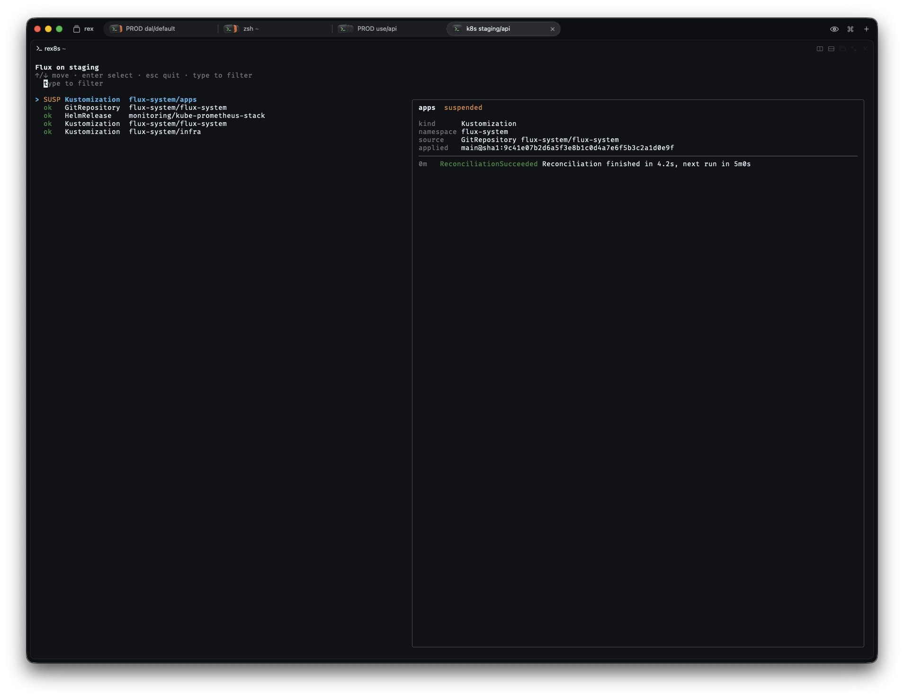 |

| `fwatch`: follow a commit until it's applied and rolled out | `kwhy`: ask Claude why a pod is unhealthy |
|---|---|
| 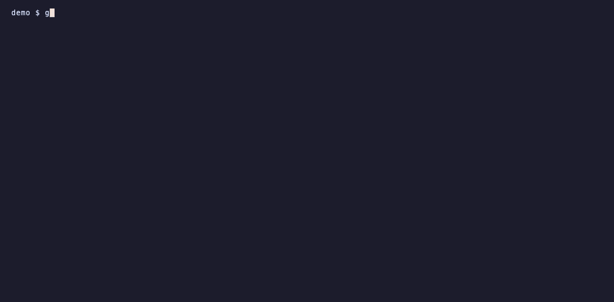 |  |
| **`kflux`**: Flux resources, failing first | **`kwarn`**: only Warning events, live |
| 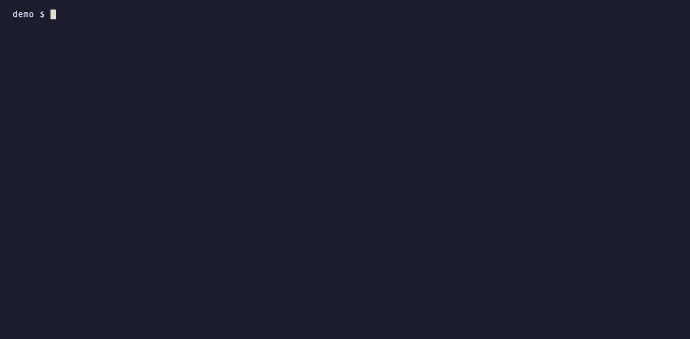 |  |
| **`kfail`**: failing pods with the crashed container's last logs | **`kjobs`**: Jobs and CronJobs with logs and recent runs |
|  | 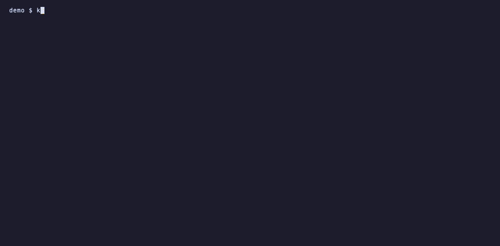 |
| **`kstatus`**: the cluster's health on one screen | **`krun`**: one command, every pod, several clusters |
| 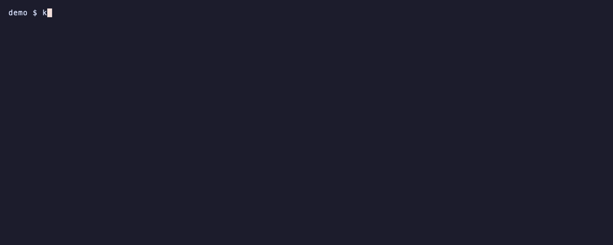 |  |
| **`kver`**: which version runs on which cluster | **`kdiff`**: the same workload on two clusters |
|  |  |
| **`kroll`**: restart workloads and follow the rollouts | **`knode`**: a shell on a node |
|  |  |
| **`kask`**: talk to Claude about the cluster or a pod | |
|  | |

All recordings use the built-in demo mode (fake `example.com` clusters) — see [Demo mode](#demo-mode).

## How it works

```
init.lua ── require("rex8s") ── rex/rex8s.lua     actions + key bindings + layouts (Lua, in the Rex server)
                                   │
                                   ▼  each pane runs
                              rex8s pick|pane|k9s|…        (Go + Bubble Tea)
                                   │
                    pane: KUBECONFIG=<pane>.yaml:~/.kube/config
                          PATH=<bin>:$PATH  →  kubectl/helm/flux = rex8s-guard
```

The pane file (`~/.cache/rex8s/<block>.yaml`) holds **only** the
current-context and namespace — no clusters, no credentials. Clusters and users
come from the master kubeconfig. This matters with OIDC: kubectl writes the
refreshed token back to the file the user entry came from, so if each pane had
its own copy of the credentials, the master's refresh token would be
invalidated ("already claimed by another client").

`rex8s-guard` is a separate binary with no TUI dependencies: Bubble Tea's
`init()` queries the terminal background color and can take up to 5s on
terminals that don't answer — unacceptable in a wrapper that runs on every
`kubectl`.

## Requirements

- [Rex](https://www.superlogical.com/rex), macOS
- Go 1.26+ (to build)
- `kubectl`; optional: `k9s`, `helm`, `flux` (for `fdiff`), `claude` (for `kwhy`),
  Node.js + Raycast (for the Raycast extension)

## Install

```sh
make install                     # test, build and install into ~/.config/rex/rex8s/bin
cp rex/rex8s.lua ~/.config/rex/    # then add require("rex8s") to init.lua
rex config reload
```

## Configuration

`~/.config/rex/rex8s/config.yaml` (everything is optional):

```yaml
kubeconfig: ~/.kube/config
hide: [ "old context" ]                    # hidden from the picker (exact name)
clusters:                                  # match = substring of the server URL
  - { match: k8s.us-east.example.com, name: use,     prod: true }
  - { match: staging.example.com,     name: staging }
prod_background: "#2b1216"                 # tint for production panes
monitor_interval: 2m                       # Flux monitor poll interval
login_url: https://login.example.com       # page kauth opens (per cluster: clusters[].login)
notifications: true                        # macOS notifications (fwatch, monitor)
ai_command: claude                         # CLI used by kwhy
ai_language: en                            # language kwhy answers in
node_debug_image: busybox:1.36             # image knode runs on the node
```

Without a config file nothing is treated as production and short names come
from the context name.

## Usage

| | |
|---|---|
| `Cmd+Shift+J` | pick cluster + namespace → new tab with an isolated shell |
| `Cmd+Shift+K` | same → new tab with k9s · shell · warnings |
| `kctx` / `kns` | switch this pane's cluster / namespace (no argument opens the picker) |
| `kauth [cluster]` | log in again when the credentials expired |
| `fdiff [-A] [filter]` | inside a git repo: what would this working tree change on the cluster(s) |
| `fwatch [-A] [--now]` | inside a git repo: follow HEAD until Flux applied it and it rolled out |
| `kflux` | Flux resources on this pane's cluster |
| `kwhy [filter]` | ask Claude why a pod is unhealthy |
| `kstatus [-w]` | cluster health on one screen (`-w`: refresh every 30s) |
| `kjobs [-n] [failed\|running\|done\|suspended\|cron] [filter]` | Jobs and CronJobs; enter: logs, run now, rerun, suspend/resume, delete |
| `krun [-c container] [name] [-- CMD...]` | pick workloads on any cluster, run CMD in all their pods |
| `kask [filter]` / `cmd \| kask` | pick the whole cluster or a pod (or pipe output in) and talk to Claude about it (`--dump`: just save the file) |
| `kver [-d] [filter]` | image tag of every workload on every cluster (`-d`: only where they differ) |
| `kdiff [filter]` | compare a workload's spec between two clusters |
| `kroll [filter]` | pick workloads on any cluster, `rollout restart` them and follow the rollouts |
| `knode [filter]` | shell on a node of this pane's cluster, in a split (`kubectl debug node`) |
| `kfail [-n] [filter]` | failing pods (all namespaces; `-n` this namespace) with events and last logs; enter: logs, why, shell, describe |
| `kwarn [-n]` | stream Warning events (all namespaces; `-n` this namespace) |
| `klogs [filter]` | follow a pod's logs in a split |
| `kexec [filter]` | shell into a pod in a split |
| `kpf [filter]` | port-forward a service in a split, on a free local port |
| `kpf -l` | running port-forwards: open, copy the URL, stop |
| `rex8s use-context CTX` | set the machine's default context (what `kubectl` uses outside rex8s panes) |
| `REX8S_FORCE=1 kubectl ...` | skip the production confirmation (scripts) |

Command palette (`Cmd+Shift+P`): **Kubernetes: Flux Monitor**, **Kubernetes: Restore Cluster Tabs**.

Picker: arrows or `ctrl+p`/`ctrl+n` move, typing filters (fuzzy), `enter` selects, `esc` quits.
Key bindings are at the bottom of `rex/rex8s.lua`.

## Integrations

Everything outside Rex is optional. How to turn each one on or off:

| Integration | Used by | On | Off |
|---|---|---|---|
| **Production tint** | every pane | default; color via `prod_background` | `prod_background: off` |
| **macOS notifications** | `fwatch`, Flux monitor | default | `notifications: false` |
| **Claude** (`claude` CLI) | `kwhy`, `kask` | found on PATH (`claude-auto`, then `claude`); or `ai_command: <cli>` | `ai_command: off` |
| **Login page** | `kauth`, picking a logged-out cluster | `login_url` (or `clusters[].login`) | remove `login_url`; `kauth` still accepts a paste |
| **Flux CLI** (`flux`) | `fdiff` | install it (`brew install fluxcd/tap/flux`) | don't use `fdiff` |
| **k9s** | `Cmd+Shift+K` layout | install it | use `Cmd+Shift+J` |
| **Raycast extension** | Open Cluster, Search Pods/Services/Flux, Flux Status menu bar | `cd raycast && npm install && npm run dev` | Raycast → Extensions → Rex Kubernetes → Uninstall (or disable single commands there) |
| **Raycast menu bar** | Flux Status, Failing Pods, Kube Context | enable the "Flux Status" / "Failing Pods" / "Kube Context" commands in Raycast | disable those commands in Raycast settings |
| **Cluster alerts** | `kstatus` | automatic when an Alertmanager (port 9093) or Prometheus (9090) service runs in the cluster; read through the API server proxy | nothing to turn off: no such service, no Alerts line |
| **Production guard** | `kubectl`/`helm`/`flux` in panes | default | `REX8S_FORCE=1` per command |

`kwhy` sends the pod's describe output (env values redacted), events and logs to
the model behind your `claude` CLI. Logs can still contain sensitive data —
turn it off with `ai_command: off` where that isn't acceptable.

## Raycast

`raycast/` is a Raycast extension on top of `rex8s list` and the Rex actions:

- **Open Cluster** — open a shell or the k9s layout (⌘L), optionally picking a namespace (⌘N).
- **Search Pods** — every pod of a cluster (crashing first): follow logs, explain with Claude (⌘E), shell into it (⌘S).
- **Search Services** — every service; port-forward on a free local port in a Rex tab.
- **Search Flux** — every Flux resource with its message; reconcile and wait for the result.
- **Flux Status** — menu bar icon: green when healthy, red with the number of failing resources.
- **Failing Pods** — menu bar: the number of broken pods across every cluster — crash loops, image pulls, config errors; finished pods are left out — red when one is in production. Click a pod to open `kfail` on it in a Rex tab.
- **Kube Context** — menu bar: the machine's default context (`~/.kube/config`), red when it is production; click a cluster to switch (`rex8s use-context`). rex8s panes are not affected. Also lists the running port-forwards: open, copy the URL or stop.

Clusters whose login expired offer "Log in" (runs `kauth` in a Rex tab).

| Search Pods | Search Flux |
|---|---|
| 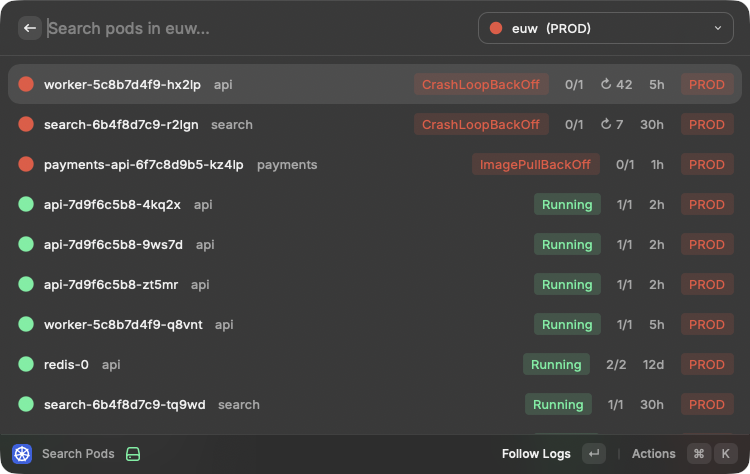 | 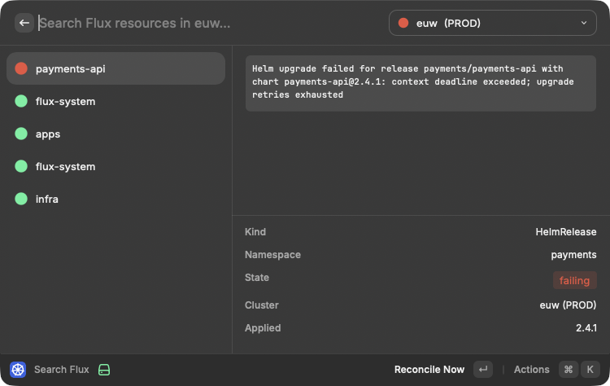 |
| **Search Services** | **Open Cluster** |
| 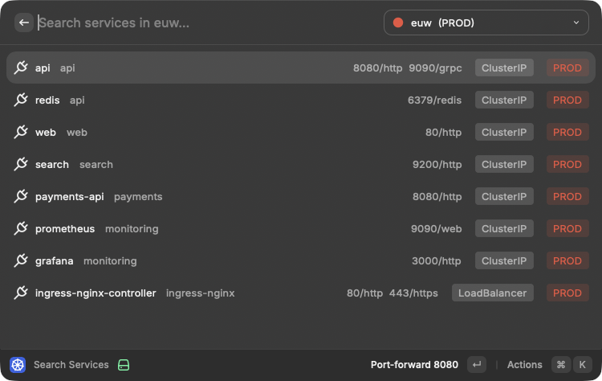 | 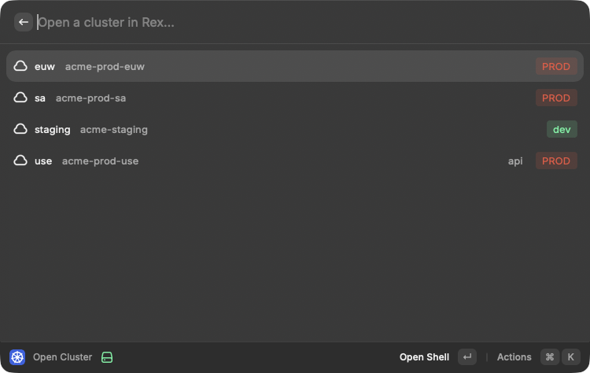 |

| **Flux Status** (menu bar) | **Kube Context** (menu bar) |
|---|---|
| 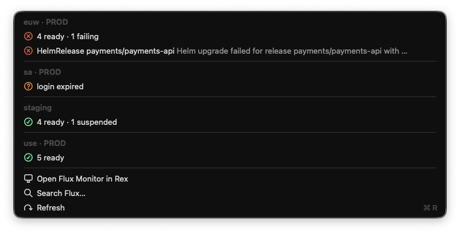 | 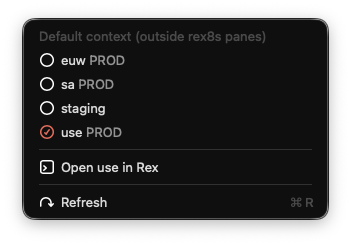 |

```sh
cd raycast && npm install && npm run dev   # imports it into Raycast
```

## Demo mode

`demo/` has a fake kubeconfig (`*.example.com` clusters) and fake `kubectl`,
`flux`, `claude` and `k9s` that answer with made-up data — crashing pods, a
failing HelmRelease, warnings, a commit rolling out. Use it to try rex8s
without a cluster, or to take screenshots without exposing real data:

`rex8s` is on `PATH` inside rex8s panes; elsewhere use `~/.config/rex/rex8s/bin/rex8s`.

```sh
rex8s demo on ~/path/to/rex8s/demo   # Rex panes, Raycast and k* commands now see only demo data
rex8s demo off
demo/record.sh                        # re-record docs/*.gif with VHS (demo mode only for the recording)
```

## Known limitations

- **Early version.** Used daily on one setup; expect rough edges.
- **macOS only.** It relies on the Rex app, `osascript` notifications and macOS
  terminal behavior.
- **Tested with Rex Beta 0.1.0 (1758).** rex8s uses the Rex CLI and Lua API,
  which may still change between beta builds.
- **Login was only tested with OIDC (Dex).** Other auth methods (EKS
  `aws eks get-token`, GKE, client certificates) should work for everything
  except `kauth`, and the "login expired" detection may miss their error
  messages. Reports welcome.
- **Flux v2 only** (`kustomize.toolkit.fluxcd.io`, `helm.toolkit.fluxcd.io`,
  `source.toolkit.fluxcd.io`).

## Development

```sh
make test
cd raycast && npx tsc --noEmit -p .
```

## License

[MIT](LICENSE)
