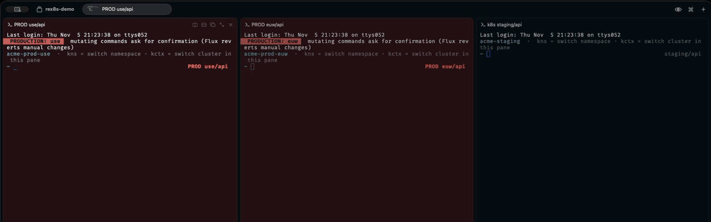
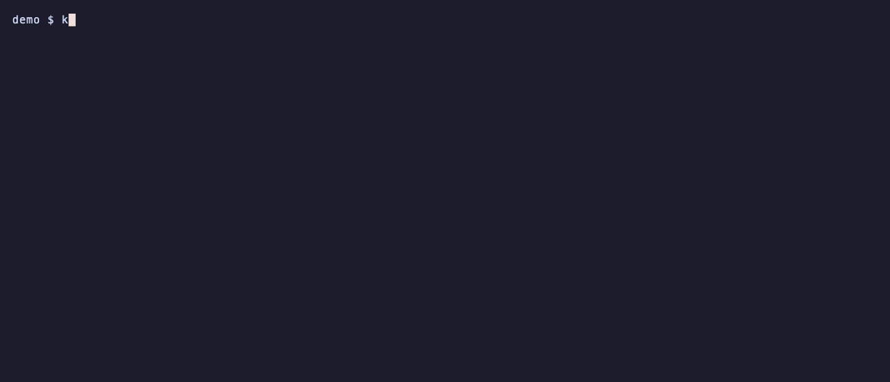
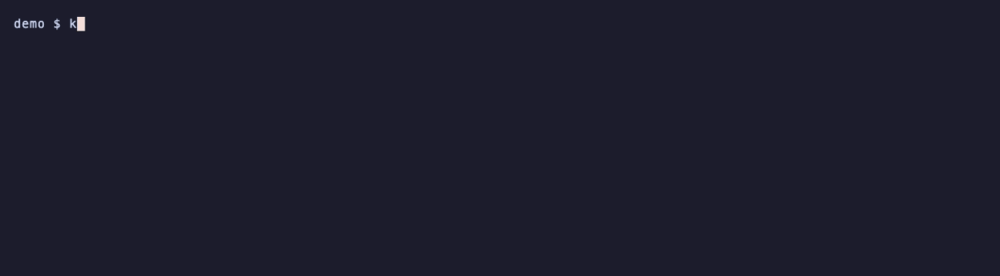
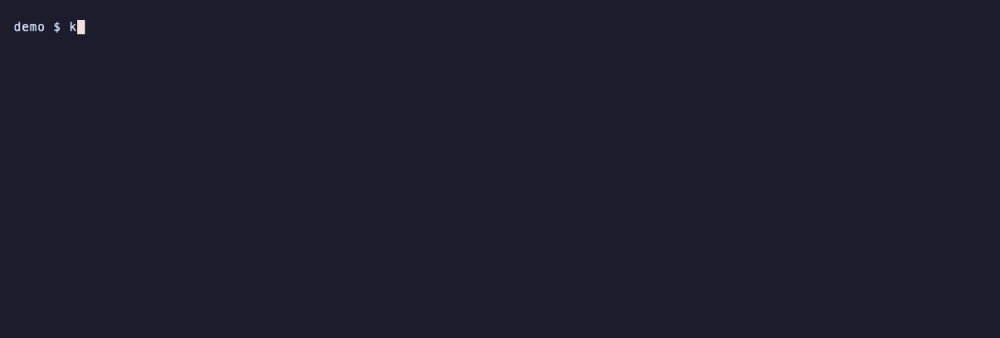
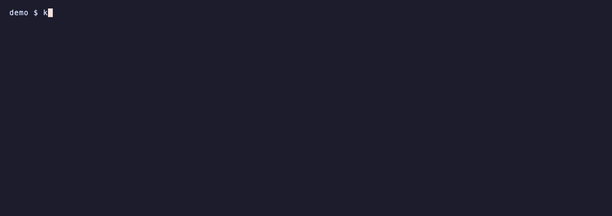
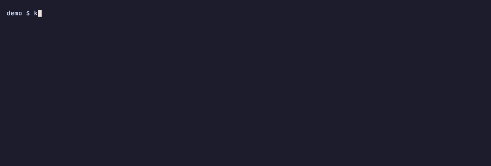

# rex8s

A Kubernetes toolkit for the [Rex](https://www.superlogical.com/rex) terminal:
isolated cluster panes, multi-cluster views, Flux (GitOps), a production guard
and Claude.


Don't remember a command? **`khelp`** lists every one in a picker, with its
usage; enter runs it.

**Panes**

- **Fuzzy picker** (Bubble Tea) with a live preview of each cluster: namespace
  count and Flux status (ready, failing, suspended, with the error message).
- **Isolated panes**: each pane has its own context and namespace. Switching in
  one pane (`kctx`, `kns`) doesn't affect the others or `~/.kube/config`.
- **Pane and tab labels** always show where you are: `PROD use/api`, `k8s staging/default`.
- **Every namespace**: pick "* all namespaces" (or `kns all`) and the pane
  shows `PROD use/*`. `kubectl get`/`describe`/`top pods`/`events`, `helm list`
  and `flux get` add `-A` by themselves; a command on one object (`logs`, `exec`,
  `delete`…) asks for `-n` instead of going to a guessed namespace. The `k*`
  pickers list every namespace, and k9s opens in all of them.
- **Production panes are tinted red**, so you can tell them apart at a glance.
  Not a fan of red? `ktint` shows presets (wine, purple, navy, teal…) and
  previews each on the pane as you move; enter saves it.
- **Production guard**: `kubectl`/`helm`/`flux` commands that mutate state, and
  `kexec` into a pod, ask you to type the cluster name first. Production is
  detected by server URL, so every alias of the same cluster is covered.
- **Expired logins** show up as "login expired" everywhere; picking such a
  cluster takes you straight to `kauth`.
- **Tabs come back** after the Rex server restarts: the picker offers to restore them.

**Flux / GitOps**

- **`fdiff`**: before you merge, preview what your working tree would change on
  each cluster (`flux diff kustomization`). Warns when your branch is behind.
- **`fwatch`**: after you push or merge, follows the change until Flux fetched
  it, every Kustomization applied it, and the Deployments/StatefulSets/
  DaemonSets (and HelmReleases) it changed finished rolling out. Progress shows
  in the Rex tab header; a notification at the end. Works with forks, merge
  commits, squash and rebase merges.
- **Flux monitor**: a dashboard of every cluster with notifications when
  something starts failing or recovers; the tab name is the health summary.
- **`kgit`**: where do I change this? Pick a workload and it follows Flux's
  labels — HelmRelease → Kustomization → GitRepository — to the repository,
  the path and, with a local clone (the current directory or `gitops_repos` in
  the config), the file and line that define it. Enter opens it in your editor
  (Cursor, VS Code, Zed or `$EDITOR`) or on GitHub. Works with any Flux setup.
- **`kflux`**: pick a Flux resource (failing first) with its events, then
  reconcile and wait, describe, or suspend/resume.

**Debugging**

- **`kwhy`**: pick a pod and ask Claude why it is unhealthy (describe with env
  values redacted, events, current and previous logs; tools disabled).
- **`kask`**: a Claude Code conversation in a split, already holding the
  context. The picker's first row is the whole cluster (kstatus, broken pods
  with their last logs, the last hour's warnings); below it every pod, broken
  first (describe with env values redacted, events, logs). `kubectl logs x |
  kask` sends whatever you pipe in. Claude can run read-only `kubectl`/`flux` commands on
  its own to dig further; anything else asks for your approval, and on
  production the guard refuses changes unless re-run with `REX8S_FORCE=1` (a
  second approval). The context is saved in `~/.cache/rex8s/dumps/`;
  `kask --dump` only saves it and prints the path. Logs are sent as they are:
  they may hold sensitive data.
- **`kincident [cluster]`**: a Rex session for an incident, already laid out:
  `kstatus -w` and the live warnings on the left, what changed lately (`kwhat`)
  and a shell on the cluster on the right. `kincident --report` writes a
  Markdown summary (timeline from an hour before the start, broken pods with
  logs, warnings) for the postmortem; `kincident --ask` opens a `kask`
  conversation on it.
- **`kdisk`**: how full the volumes are — each PVC's real usage, read from the
  nodes' kubelets, and the nodes' own disks, fullest first (above 70% by
  default, `-a` all, `-A` every cluster). Local-path/hostPath PVCs, which
  share their node's disk, are listed under the node.
- **`kreq`**: requests and limits against real usage (`kubectl top`): what is
  near its memory limit (OOM risk), what reserves far more than it uses (cost,
  with the total), and what has no requests.
- **`kstatus`**: the cluster's health on one screen — nodes (pressure, CPU/memory),
  pods, unavailable workloads, Flux, failed jobs, firing alerts (from an
  Alertmanager or Prometheus inside the cluster, when there is one), expiring
  certificates (cert-manager) and the last hour's warnings. `-w` refreshes.
- **`kjobs`**: Jobs and CronJobs, failed first, with logs and recent runs in the
  preview; run a CronJob now, rerun, suspend/resume, delete.
- **`kfail`**: only the unhealthy pods of the cluster, with their recent events and
  last log lines in the preview — the crashed container's logs when it restarted.
  Logs are fetched only for the pod under the cursor. Enter: logs, why, ask
  (a `kask` conversation), shell, describe, events.
- **`kwarn`**: only Warning events (OOMKilled, BackOff, probes, image pulls),
  deduplicated. Also the bottom pane of the k9s layout.
- **`krun`**: run a command in every pod of workloads on several clusters at
  once. `krun` opens a picker with every Deployment, StatefulSet and DaemonSet
  of every cluster (names may differ per cluster): type to filter, mark with
  space (ctrl+a marks all shown) or just press enter for one, then type the
  command. `krun nginx -- nginx -s reload` skips the questions when only one
  workload matches. Production asks once, with a y/N.
- **`klogs`**: follow logs in a split. The picker lists the namespace's
  workloads first — all their pods merged into one stream, and the new ones
  join after a rollout — then single pods. `klogs -A` follows workloads on
  several clusters at once (mark them), each line tagged with its cluster.
  `-g REGEX` keeps only matching lines (highlighted) and `-s 1h` starts an
  hour back.
- **`kgrep`**: `klogs` that searches — pick a workload or pod, then type what
  to look for; it keeps following, so new matches keep coming. `kgrep timeout`
  skips the question, `kgrep -A` works across clusters.
- Splits you only watch (logs, port-forwards, `kwhy`'s answer) open without
  taking the focus, so you keep typing in your shell; the ones you type in
  (`kexec`, `knode`, `knet`, `kask`) take it.
- **`kexec`**, **`kpf`**: pick a pod or service and open a shell in it, or
  port-forward it — in a split next to your shell.
  `kpf -l` lists the running port-forwards: open, copy the URL or stop one
  (they also show in the Kube Context menu bar). Favorites from the config
  (`forwards:`): `kpf grafana` starts it and opens the browser — or just the
  browser when it already runs; `kpf -f` picks one. To make one, start a
  forward and pick **save** in `kpf -l` (or **Save as Favorite** in the menu bar).
- **`knet`**: a throwaway pod with network tools (netshoot: curl, dig, nc,
  tcpdump) in this pane's namespace, in a split — "does the service answer from
  inside the cluster?". Removed when you exit; production asks first.
- **`knode`**: pick a node and get a shell on it in a split (`kubectl debug
  node`, the node's filesystem at `/host`). The debug pod is removed when you
  exit. Production asks first.

**Across clusters**

- **`kmulti`**: a tab with one pane per cluster, side by side (a grid from
  four on) — each an isolated pane with its own label and production tint.
  Pick the clusters, or name a group from the config (`kmulti prod`).
  `kmulti -n api get pods` has every pane run the command first and stay a
  shell. In that tab, **`kall CMD`** types `CMD` in every cluster pane at once
  (production panes still ask before a change). **⇧⌘M** opens the picker in
  a new tab; also in the palette: **Kubernetes: Clusters Side by Side…**.
- **`kwhat`**: what changed? A timeline of every cluster, newest first:
  rollouts with the image change (or "rollout restart"), what Flux applied,
  Helm upgrades and failures, new commits fetched. `kwhat 6h api` widens the
  window and filters; Flux's part comes from events, which the API server keeps
  about an hour.
- **`kjunk [debug|pods|jobs|pv]`**: leftovers on every cluster — ended debug
  pods (`knode`, `knet`, `kubectl debug`), Failed/Evicted pods over a day old,
  Jobs finished over a week ago (not a CronJob's: its history limit handles
  those) and Released PVs. Mark them and delete; a category narrows the list,
  and production asks once (y/N).
- **`kcron`**: what CronJobs run next on every cluster — one timeline, with
  how the last run went (frequent jobs are folded). `kcron 24h backup`.
- **`kver`**: which version runs where — the image tag of every workload, one
  column per cluster. Rows that differ come first and are highlighted; `-d`
  shows only those.
- **`kdiff`**: compare a workload's spec between two clusters (YAML, without
  status and the fields the API server fills in). Pick one row and it finds the
  same name on the other cluster, or mark two rows.
- **`kroll`**: restart the workloads you mark (same picker as `krun`) and follow
  each rollout until it is done, with progress in the tab header. Production
  asks once, with a y/N.

### See it

| Production tab: k9s · shell · warnings, tinted red | `kflux` on a staging tab |
|---|---|
|  |  |

**`kmulti`** (⇧⌘M): clusters side by side — `kall` types the same command in all of them



| `fwatch`: follow a commit until it's applied and rolled out | `kwhy`: ask Claude why a pod is unhealthy |
|---|---|
|  |  |
| **`kflux`**: Flux resources, failing first | **`kwarn`**: only Warning events, live |
|  |  |
| **`kfail`**: failing pods with the crashed container's last logs | **`kjobs`**: Jobs and CronJobs with logs and recent runs |
|  |  |
| **`kstatus`**: the cluster's health on one screen | **`krun`**: one command, every pod, several clusters |
|  |  |
| **`kver`**: which version runs on which cluster | **`kdiff`**: the same workload on two clusters |
|  |  |
| **`kroll`**: restart workloads and follow the rollouts | **`knode`**: a shell on a node |
|  |  |
| **`kask`**: talk to Claude about the cluster or a pod | **`kwhat`**: what changed, on every cluster |
|  |  |
| **`klogs`**: a workload's pods in one stream | **`knet`**: network tools inside the namespace |
|  |  |
| **`kgrep`**: search a workload's logs, matches highlighted | **`kgit`**: from a workload to the file that defines it |
|  |  |
| **`kdisk`**: how full the volumes are | **`kreq`**: requests and limits vs real usage |
|  |  |
| **`kcron`**: CronJob runs coming up on every cluster | **`kjunk`**: leftovers to clean up |
|  |  |
| **`khelp`**: every command, enter runs it | **`ktint`**: pick the production color |
|  |  |

All recordings use the built-in demo mode (fake `example.com` clusters) — see [Demo mode](#demo-mode).

## How it works

```
init.lua ── require("rex8s") ── rex/rex8s.lua     actions + key bindings + layouts (Lua, in the Rex server)
                                   │
                                   ▼  each pane runs
                              rex8s pick|pane|k9s|…        (Go + Bubble Tea)
                                   │
                    pane: KUBECONFIG=<pane>.yaml:~/.kube/config
                          PATH=<bin>:$PATH  →  kubectl/helm/flux = rex8s-guard
```

The pane file (`~/.cache/rex8s/<block>.yaml`) holds **only** the
current-context and namespace — no clusters, no credentials. Clusters and users
come from the master kubeconfig. This matters with OIDC: kubectl writes the
refreshed token back to the file the user entry came from, so if each pane had
its own copy of the credentials, the master's refresh token would be
invalidated ("already claimed by another client").

`rex8s-guard` is a separate binary with no TUI dependencies: Bubble Tea's
`init()` queries the terminal background color and can take up to 5s on
terminals that don't answer — unacceptable in a wrapper that runs on every
`kubectl`.

## Requirements

- [Rex](https://www.superlogical.com/rex), macOS
- Go 1.26+ (to build)
- `kubectl`; optional: `k9s`, `helm`, `flux` (for `fdiff`), `claude` (for `kwhy`),
  Node.js + Raycast (for the Raycast extension)

## Install

From source (Go 1.26+):

```sh
make install        # tests, builds, then rex8s setup
```

Or from a [release](https://github.com/vitalbh/rex8s/releases) (macOS and Linux, arm64 and amd64):

```sh
tar xzf rex8s_<version>_darwin_arm64.tar.gz
./rex8s_<version>_darwin_arm64/rex8s setup
```

`rex8s setup` does everything, and can be run again any time (after an
upgrade, say): it puts `rex8s` and `rex8s-guard` in `~/.config/rex/rex8s/bin`
with the `k*` commands and the `kubectl`/`helm`/`flux` guard, writes
`~/.config/rex/rex8s.lua`, adds `require("rex8s")` to Rex's `init.lua` and
reloads Rex's config.

- **`rex8s doctor`** checks the installation and what rex8s uses: the commands,
  the Lua file (and whether it matches this version), Rex, kubectl, flux, k9s,
  claude, the config, the kubeconfig, `gitops_repos`, favorite forwards.
- **`rex8s uninstall`** undoes `setup`; your `config.yaml` stays.

### Coding agents

```sh
rex8s agents install            # every agent you have: Claude Code, Codex (~/.agents), Cursor
rex8s agents install codex      # or only some: claude, codex, cursor
```

writes a small skill that tells the agent to run `rex8s agent-guide` — the
guide ships in the binary, so it follows rex8s upgrades. With it, an agent
answers "what changed?", "what's broken?", "which version runs where?" with
`kwhat`, `rex8s list failing`, `kver`, `kdisk`… across every cluster, and
knows the production rules: a `kubectl`/`helm`/`flux` command that changes a
production cluster, run without a terminal (by any agent, or a script), is
refused until you agree and it is re-run with `REX8S_FORCE=1`.
`rex8s agents status` / `remove` take the same agent names.

`kask` opens Claude Code or Codex: `rex8s setup` asks once when you have both
(with one, it uses that one), and `rex8s config set ask_agent claude|codex`
changes it. Codex asks before each command it runs.

## Configuration

`~/.config/rex/rex8s/config.yaml` (everything is optional). `rex8s config`
lists the settings; `rex8s config set KEY VALUE`, `unset KEY`, and
`add`/`remove KEY VALUE` for lists change them without touching the rest of the
file (comments included) — refusing if you saved the file meanwhile, and undoing
a change that would break it. Clusters and forwards are edited in the file.

```yaml
kubeconfig: ~/.kube/config
hide: [ "old context" ]                    # hidden from the picker (exact name)
clusters:                                  # match = substring of the server URL
  - { match: k8s.us-east.example.com, name: use,     prod: true }
  - { match: staging.example.com,     name: staging }
prod_background: "#2b1216"                 # tint for production panes
monitor_interval: 2m                       # Flux monitor poll interval
login_url: https://login.example.com       # page kauth opens (per cluster: clusters[].login)
notifications: true                        # macOS notifications (fwatch, monitor, Failing Pods)
ai_command: claude                         # CLI used by kwhy
ai_language: en                            # language kwhy and kask answer in
ask_agent: claude                          # kask opens claude or codex
node_debug_image: busybox:1.36             # image knode runs on the node
net_debug_image: nicolaka/netshoot:v0.13   # image knet runs in the namespace
gitops_repos: [ ~/dev/gitops ]             # local clones of the Flux repos, for kgit
groups: { prod: [ use, euw ] }             # cluster sets for kmulti GROUP
forwards:                                  # favorite port-forwards: kpf NAME, Raycast menu bar
  - { name: grafana, cluster: use, namespace: monitoring, service: grafana, port: 3000, path: /dashboards }
  - { name: prometheus, cluster: staging, namespace: monitoring, service: prometheus, port: 9090 }
```

### In any shell

The `k*` commands live in `~/.config/rex/rex8s/bin`, which rex8s panes put on
`PATH`. To have them in every shell:

```sh
echo 'export PATH="$HOME/.config/rex/rex8s/bin:$PATH"' >> ~/.zshrc
```

Outside a rex8s pane they use the machine's default context (`kubectl config
use-context`, or the Raycast Kube Context menu), and the `kubectl`/`helm`/`flux`
wrappers bring the production confirmation along. Outside Rex, commands that
open a split run in the terminal itself.

To see the cluster in the prompt (instant: it reads the kubeconfig, never the
cluster) — `PROD dal/ns` in red for production:

```sh
# zsh, with oh-my-zsh or setopt prompt_subst
RPROMPT='$(~/.config/rex/rex8s/bin/rex8s-guard --prompt)'
```

`rex8s-guard --prompt plain` prints it without zsh color codes, for other
shells and prompt tools.

Without a config file nothing is treated as production and short names come
from the context name.

## Usage

| | |
|---|---|
| `Cmd+Shift+J` | pick cluster + namespace → new tab with an isolated shell |
| `Cmd+Shift+K` | same → new tab with k9s · shell · warnings |
| `Cmd+Shift+M` | pick several clusters → a tab with one pane each, side by side (`kall` types in all) |
| `khelp [filter]` | every rex8s command in a picker, with usage; enter runs it |
| `ktint [#hex\|off] [--save]` | production background: presets previewed live (enter saves), or try a color in this pane |
| `kctx` / `kns` | switch this pane's cluster / namespace (no argument opens the picker; `kns all`: every namespace) |
| `kauth [cluster]` | log in again when the credentials expired |
| `fdiff [-A] [filter]` | inside a git repo: what would this working tree change on the cluster(s) |
| `fwatch [-A] [--now]` | inside a git repo: follow HEAD until Flux applied it and it rolled out |
| `kflux` | Flux resources on this pane's cluster |
| `kwhy [filter]` | ask Claude why a pod is unhealthy |
| `kstatus [-w]` | cluster health on one screen (`-w`: refresh every 30s) |
| `kjobs [-n] [failed\|running\|done\|suspended\|cron] [filter]` | Jobs and CronJobs; enter: logs, run now, rerun, suspend/resume, delete |
| `krun [-c container] [name] [-- CMD...]` | pick workloads on any cluster, run CMD in all their pods |
| `kask [filter]` / `cmd \| kask` | pick the whole cluster or a pod (or pipe output in) and talk to Claude about it (`--dump`: just save the file) |
| `kver [-d] [filter]` | image tag of every workload on every cluster (`-d`: only where they differ) |
| `kdiff [filter]` | compare a workload's spec between two clusters |
| `kroll [filter]` | pick workloads on any cluster, `rollout restart` them and follow the rollouts |
| `knode [filter]` | shell on a node of this pane's cluster, in a split (`kubectl debug node`) |
| `kfail [-n] [filter]` | failing pods (all namespaces; `-n` this namespace) with events and last logs; enter: logs, why, ask, shell, describe |
| `kwarn [-n]` | stream Warning events (all namespaces; `-n` this namespace) |
| `klogs [-A] [filter]` | follow a workload's pods (merged) or one pod in a split; `-A`: workloads on several clusters |
| `kgrep [-A] [pattern]` | search the logs of a workload or pod (asks the pattern after the pick) |
| `kjunk [debug\|pods\|jobs\|pv] [filter]` | leftovers on every cluster: mark and delete |
| `kcron [duration] [filter]` | upcoming CronJob runs on every cluster (default 6h) |
| `kmulti [group] [-n ns\|-A] [cmd...]` | a tab with one pane per cluster, side by side |
| `kall cmd...` | type `cmd` in every cluster pane of this tab |
| `kgit [filter]` | where a workload is defined in the GitOps repo (Flux): open the file |
| `kdisk [-A] [-a] [filter]` | how full PVCs and node disks are |
| `kreq [-n] [filter]` | requests/limits vs usage: OOM risk, over-provisioned, no requests |
| `kincident [cluster]` · `--report` · `--ask` | a Rex session laid out for an incident; Markdown report; talk to Claude about it |
| `kpf NAME` · `kpf -f` | a favorite port-forward: start it (if needed) and open the browser |
| `kwhat [duration] [filter]` | what changed on every cluster (default the last hour) |
| `knet` | network toolbox pod in this namespace, in a split |
| `kexec [filter]` | shell into a pod in a split |
| `kpf [-n] [filter]` | port-forward a service in a split, on a free local port (every namespace, this pane's first; `-n`: only it) |
| `kpf -l` | running port-forwards: open, copy the URL, save as a favorite, stop |
| `rex8s use-context CTX` | set the machine's default context (what `kubectl` uses outside rex8s panes) |
| `REX8S_FORCE=1 kubectl ...` | skip the production confirmation (scripts) |

Command palette (`Cmd+Shift+P`): **Kubernetes: Flux Monitor**, **Kubernetes: Restore Cluster Tabs**.

Picker: arrows or `ctrl+p`/`ctrl+n` move, typing filters (fuzzy), `enter` selects, `esc` quits.
Key bindings are at the bottom of `rex/rex8s.lua`.

## Integrations

Everything outside Rex is optional. How to turn each one on or off:

| Integration | Used by | On | Off |
|---|---|---|---|
| **Production tint** | every pane | default; color via `prod_background` or `ktint` | `prod_background: off` (or `ktint off --save`) |
| **macOS notifications** | `fwatch`, Flux monitor, Failing Pods menu bar (a pod that newly broke) | default | `notifications: false` |
| **Claude** (`claude` CLI) | `kwhy`, `kask` | found on PATH (`claude-auto`, then `claude`); or `ai_command: <cli>` | `ai_command: off` |
| **Login page** | `kauth`, picking a logged-out cluster | `login_url` (or `clusters[].login`) | remove `login_url`; `kauth` still accepts a paste |
| **Flux CLI** (`flux`) | `fdiff` | install it (`brew install fluxcd/tap/flux`) | don't use `fdiff` |
| **k9s** | `Cmd+Shift+K` layout | install it | without it, the layout shows `kstatus -w` in its place |
| **Raycast extension** | Open Cluster, Search Pods/Services/Flux, Flux Status menu bar | `cd raycast && npm install && npm run dev` | Raycast → Extensions → Rex Kubernetes → Uninstall (or disable single commands there) |
| **Raycast menu bar** | Flux Status, Failing Pods, Alerts, Kube Context | enable the "Flux Status" / "Failing Pods" / "Alerts" / "Kube Context" commands in Raycast | disable those commands in Raycast settings |
| **Cluster alerts** | `kstatus` | automatic when an Alertmanager (port 9093) or Prometheus (9090) service runs in the cluster; read through the API server proxy | nothing to turn off: no such service, no Alerts line |
| **Production guard** | `kubectl`/`helm`/`flux` in panes (and any shell with the PATH) | default: asks at a terminal; without one (agents, scripts) refuses | `REX8S_FORCE=1` per command |

`kwhy` sends the pod's describe output (env values redacted), events and logs to
the model behind your `claude` CLI. Logs can still contain sensitive data —
turn it off with `ai_command: off` where that isn't acceptable.

## Raycast

`raycast/` is a Raycast extension on top of `rex8s list` and the Rex actions:

- **Open Cluster** — open a shell or the k9s layout (⌘L), optionally picking a namespace (⌘N).
- **Search Pods** — every pod of a cluster (crashing first): follow logs, explain with Claude (⌘E), talk to Claude about it (⌘⇧E, `kask`), shell into it (⌘S).
- **Search Services** — every service; port-forward on a free local port in a Rex tab.
- **Search Workloads** — every workload of every cluster, with its version on each (orange when they differ): follow the logs of all its pods (on every cluster or one), search them (⌘G, a pattern), restart (⌘⇧R; production asks again in the tab).
- **Search Flux** — every Flux resource with its message; reconcile and wait for the result.
- **Flux Status** — menu bar icon: green when healthy, red with the number of failing resources.
- **Failing Pods** — menu bar: the number of broken pods across every cluster — crash loops, image pulls, config errors; finished pods are left out — red when one is in production. Click a pod to open `kfail` on it in a Rex tab. A macOS notification when a pod newly breaks (once per workload; turn off with `notifications: false`).
- **Alerts** — menu bar: firing alerts of every cluster (from the Alertmanager or Prometheus running in it), critical first, and a macOS notification when a critical one starts. Says so when a cluster's Prometheus has no alerting rules. Click: `kstatus` of that cluster in Rex.
- **Kube Context** — menu bar: the machine's default context (`~/.kube/config`), red when it is production; click a cluster to switch (`rex8s use-context`). rex8s panes are not affected. Also lists the favorite forwards (click: open, starting it when needed) and the running ones: open, copy the URL or stop.

Clusters whose login expired offer "Log in" (runs `kauth` in a Rex tab).

Tabs opened from Raycast go to the Rex session named in the extension's
**Rex session** preference (default `k8s`, created when missing): Rex can't
tell which session the app is showing, so Raycast uses a known one and then
shows it.

To land on the new tab, turn on **Remote Control** in Rex (Settings → Rex
Server): it lets the extension ask the app to switch session and tab. Without
it the tab still opens, just in the background. (The ⇧⌘J/⇧⌘K picker doesn't
need it: that request starts in the app itself.)

| Search Pods | Search Flux |
|---|---|
|  |  |
| **Search Services** | **Open Cluster** |
|  |  |

| **Flux Status** (menu bar) | **Kube Context** (menu bar) |
|---|---|
|  |  |

```sh
cd raycast && npm install && npm run dev   # imports it into Raycast
```

## Demo mode

`demo/` has a fake kubeconfig (`*.example.com` clusters) and fake `kubectl`,
`flux`, `claude` and `k9s` that answer with made-up data — crashing pods, a
failing HelmRelease, warnings, a commit rolling out. Use it to try rex8s
without a cluster, or to take screenshots without exposing real data:

`rex8s` is on `PATH` inside rex8s panes; elsewhere use `~/.config/rex/rex8s/bin/rex8s`.

```sh
rex8s demo on ~/path/to/rex8s/demo   # Rex panes, Raycast and k* commands now see only demo data
rex8s demo off
demo/record.sh                        # re-record docs/*.gif with VHS (demo mode only for the recording)
```

## Known limitations

- **Early version.** Used daily on one setup; expect rough edges.
- **macOS only.** It relies on the Rex app, `osascript` notifications and macOS
  terminal behavior.
- **Tested with Rex Beta 0.1.0 (1758).** rex8s uses the Rex CLI and Lua API,
  which may still change between beta builds.
- **Login was only tested with OIDC (Dex).** Other auth methods (EKS
  `aws eks get-token`, GKE, client certificates) should work for everything
  except `kauth`, and the "login expired" detection may miss their error
  messages. Reports welcome.
- **Flux v2 only** (`kustomize.toolkit.fluxcd.io`, `helm.toolkit.fluxcd.io`,
  `source.toolkit.fluxcd.io`).

## Development

```sh
make test
cd raycast && npx tsc --noEmit -p .
```

## License

[MIT](LICENSE)
