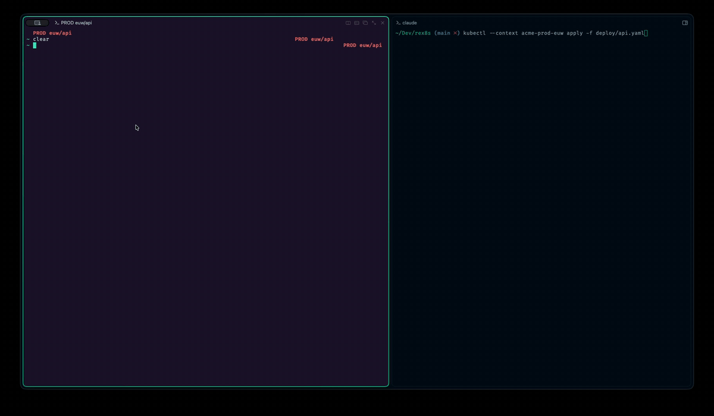
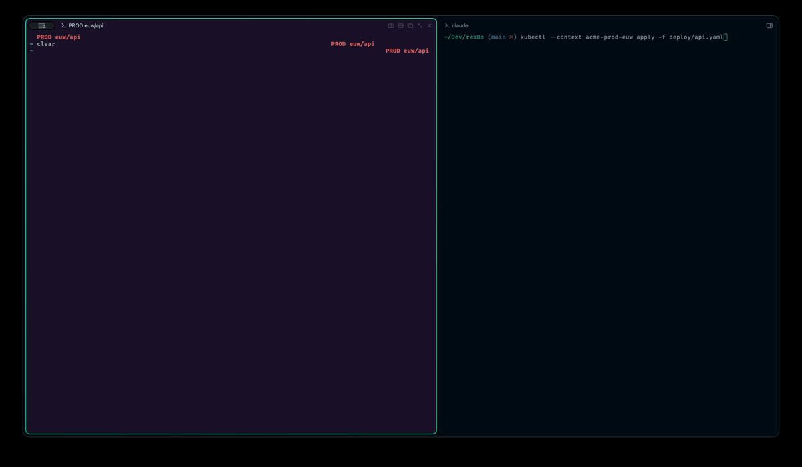

# Commands

In Rex, **`khelp`** lists all of these in a picker (enter runs one). In
pickers: arrows or `ctrl+p`/`ctrl+n` move, typing filters (fuzzy), `space`
marks several where that makes sense, `enter` selects, `esc` quits.

Most commands work on this pane's cluster; **`-A`** makes them work on every
cluster. Splits you only watch (logs, `kwhy`'s answer) open without taking
the focus, so you keep typing in your shell; the ones you type in (`kexec`,
`knode`, `knet`, `kask`) take it. Port-forwards open no split: they run in the
background.

- [Keys](#keys) · [Panes](#panes) · [Browse](#browse) · [What's broken](#whats-broken) ·
  [Logs](#logs) · [Ask Claude](#ask-claude) · [Reach a service or a pod](#reach-a-service-or-a-pod) ·
  [Flux / GitOps](#flux--gitops) · [Across clusters](#across-clusters) · [rex8s subcommands](#rex8s-subcommands)

## Keys

| | |
|---|---|
| `⇧⌘J` | pick cluster + namespace → new tab with an isolated shell |
| `⇧⌘K` | same → new tab with `kview` · shell · warnings (`cluster_browser: k9s` for k9s) |
| `⇧⌘M` | pick several clusters → a tab with one pane each, side by side |
| `⇧⌘V` | new tab with `kview -A`: every cluster, no picker |
| `⇧⌘I` | in a cluster shell: jump to the `kview` of the same cluster in this tab (the ⇧⌘K layout's counts), or open one in a split; in a `kview`: back to a shell of its cluster |
| `⇧⌘P` (palette) | **Kubernetes: Flux Monitor**, **Clusters Side by Side…**, **All Clusters (kview)**, **Restore Cluster Tabs**, **Favorite Port-forwards…** (`kpf -f`), **Running Port-forwards** (`kpf -l`), **Open This Pane's Cluster in kview**, **Type in Every Cluster Pane (kall)…**, **Toggle Cluster Shell / kview** (⇧⌘I), **Unlock Production for a While…** / **Lock Production Again…** (`kunlock`), **Restart Workloads…** (`kroll`), **Workload Logs…** (`klogs`/`kgrep`), **Flux Resources…** (`kflux`), **Incident Session…** (`kincident`), **Find an Object by Name…** (`kfind`) |

The palette actions ask their questions in the palette itself — pick a
cluster, tick workloads, type a filter — in every connected Rex app, the
iPhone's too (Rex preview.21 or newer: API revision 17; `rex8s doctor`
checks it). A favorite web UI opens in the browser, a database's URL is
copied (a notification says so). On an older Rex the port-forward, ⇧⌘M and
`kall` actions open the rex8s picker in a floating pane instead (it closes
when you're done, and stays until enter when there is something to read), and
the newer flows say which command to type. A pane is a cluster shell or a
`kview` by its label (`PROD use/api`, `kview PROD use/api`), which rex8s sets.

| **Cluster Health…** → a cluster → Pods → Logs | **Flux Resources…** → reconcile (production asks in the pane) |
|---|---|
|  |  |

**Favorite Port-forwards…**: a web UI opens in the browser, a database's URL is copied

Key bindings are at the bottom of `rex/rex8s.lua`.

## Panes

- **Cluster picker** with a live preview of each cluster: namespace count and
  Flux status (ready, failing, suspended, with the error message).
- **Isolated panes**: each pane has its own context and namespace. Switching in
  one pane doesn't affect the others or `~/.kube/config`.
- **Labels** always show where you are: `PROD use/api`, `k8s staging/default`.
- **Every namespace**: pick "* all namespaces" (or `kns all`) and the pane
  shows `PROD use/*`. `kubectl get`/`describe`/`top pods`/`events`, `helm list`
  and `flux get` add `-A` by themselves; a command on one object (`logs`,
  `exec`, `delete`…) asks for `-n` instead of guessing. The `k*` pickers list
  every namespace, and the ⇧⌘K browser opens on all of them.
- **Production guard**: `kubectl`/`helm`/`flux` commands that change state
  (`exec`, `debug`, `cp`, `flux reconcile` and `helm test` included), and the
  rex8s commands that change a cluster (`kexec`, `knode`, `knet`, `krun`,
  `kroll`, `kjunk`, kflux's reconcile), ask you to type the cluster name first.
  A command the guard doesn't know (a kubectl plugin, a typo, an unknown flag
  before the verb) asks too. With no terminal to ask (an agent, a script),
  the Rex palette asks instead — "Claude Code wants to change PRODUCTION
  use", with the command, on the Mac and the iPhone: **Allow once** lets that
  one command through, **Deny** refuses it and tells the agent not to retry.
  Unanswered in 90s, without Rex, or with `guard_palette: false`, it is
  refused until re-run with `REX8S_FORCE=1`. Production is detected
  by server URL, so every alias of the same cluster is covered, including
  `--cluster`, `--server`, `--user` and `HELM_KUBECONTEXT`. Each decision
  (confirmed, cancelled, refused, forced, unlocked, approved, denied) is logged in
  `~/.cache/rex8s/audit.log`. During an incident, `kunlock` stops the
  questions for a while. `guard: false` in the config turns it off entirely
  (`rex8s setup` then removes the `kubectl`/`helm`/`flux` links; nothing asks
  and nothing is logged); `rex8s setup` asks about it the first time at a
  terminal.

  The guard is a client-side safety net against slips, not a security
  boundary: it only sees commands that go through it (and any Rex app
  connected to your server can answer the palette). A `kubectl` run by its
  full path (`/opt/homebrew/bin/kubectl`), k9s, Lens, or any program built on
  client-go changes production without asking. For a real barrier, use RBAC
  on the server — a read-only context for daily work and a separate one with
  write access — or admission policies.
- **Expired logins** show up as "login expired" everywhere; picking such a
  cluster takes you straight to `kauth`.
- **Tabs come back** after the Rex server restarts: the picker offers to
  restore them.

| | |
|---|---|
| `kctx [CTX]` / `kns [NS\|all]` | switch this pane's cluster / namespace (no argument: picker) |
| `kauth [cluster]` | log in again when the credentials expired: opens the login page and reads the pasted `kubectl config set-cluster`/`set-credentials`/`set-context`/`use-context` commands (only those, and never `--exec-*` or `--kubeconfig`) |
| `ktint [#hex\|off] [--save]` | production background: presets previewed live on the pane (enter saves), or try a color here |
| `khelp [filter]` | every command in a picker, with usage; enter runs it |
| `rex8s use-context CTX` | the machine's default context (what `kubectl` uses outside rex8s panes) |
| `kunlock [cluster…\|all] [15m]` | production changes go through without typing the name, for a while (default: this pane's cluster, 15m; at most 12h) — like sudo's grace period. Agents get through too (no `REX8S_FORCE` on every command), but only you can unlock: `kunlock` itself refuses agents and scripts. `kunlock off` locks again, `kunlock -l` lists |
| `REX8S_FORCE=1 kubectl …` | skip the production confirmation (scripts) |

## Browse

**`kview [-A [GROUP | CLUSTER,…] | --context CTX] [pods|workloads|services|jobs|nodes|warnings]`** —
the cluster in one screen, like k9s: a tab per kind of object (**tab** or
**1–6** switch), each list live — it watches the API server, so a pod that
starts, crashes or goes shows within a second — and the cursor staying on its
row as it does. A row that just appeared (**+**) or changed (**~**: status,
ready, restarts; not an age ticking) is highlighted for a few seconds. The
status line says `live`; `live · polling sa` when some clusters are read
with `kubectl` on every refresh instead (a legacy `auth-provider` login, a
kind that cluster doesn't have). A tab you haven't looked at for 5 minutes
stops its watches, and starts them again when you go back to it. **`/`**
filters (every word, any column; **esc** clears), **R** reloads, **?**
lists every key, **q** quits. `-A` lists every cluster's,
production in red; `-A prod` only a group of the config (`groups: {prod:
[use, euw]}`), `-A use,euw` only the clusters named (`kview -A use euw nodes`
works too).

| Tab | Keys |
|---|---|
| pods | **enter** its owner · **l** logs · **p** previous logs · **s** shell · **d** describe · **e** events · **y** YAML · **w** why · **a** ask · **ctrl+d** delete |
| workloads | **enter** its pods · **l** logs of all its pods · **r** restart · **d** describe · **y** YAML |
| services | **enter** port-forward in the background (as `kpf`), and the browser opens for HTTP · **o** its pods · **d** describe · **y** YAML |
| jobs | **enter** a CronJob's runs, a Job's pods · **l** logs (a CronJob: of its last run) · **r** run a CronJob now / rerun a Job · **d** describe · **y** YAML |
| nodes | **enter** its pods · **s** shell on the node · **d** describe · **y** YAML |
| warnings | **enter** go to the object · **d** describe it |
| `:KIND` | **d** describe · **y** YAML · **ctrl+d** delete |

**Any kind: `:`** opens a tab for another kind, like k9s: `:ingress`, `:cm`,
`:secret`, `:pvc`, `:hpa`, `:crd`, or any resource name or short name, CRDs
and their objects included. No need to remember short names: as you type, a
list shows every kind whose name, short name or Kind contains it, by full name
(`map` finds `configmaps (cm)`); **↑↓** choose, **tab** completes, **enter**
opens the highlighted one (from `kubectl api-resources`).
It shows the columns the API server prints for that kind (`kubectl get -o
wide`: a CRD's printer columns too), with `-A` too, live like the other tabs
(the API server prints the rows of a watch), and the filter, marks and
sorting work as on the other tabs; **esc** goes back to the fixed tabs. `:po`,
`:deploy`, `:svc`, `:no`… go to their own tab.

**Jobs.** One row per CronJob — schedule, its last run (how it went, how
long ago), the next one, how many run now — and per Job of its own, failing
first (a CronJob whose last run failed, a Job that failed), then running. A
CronJob's runs, most of a cluster's Jobs, stay out of the list: **enter** on
it shows them, newest first (**esc** back); a pod's **enter** still reaches
its Job there.

**Following links.** **enter** on a pod goes to its workload (through its
ReplicaSet to the Deployment; or its StatefulSet, DaemonSet, Job), on a node
to its pods, on a warning to the object's tab showing only that object, on a
workload to its pods (by its selector, in its cluster and namespace); **o** on
a service to the pods its selector picks (its endpoints). **esc** or
**backspace** goes back where you came from, with the filter you had.

**Marks.** **space** marks a row (●), **ctrl+a** marks every row shown (again:
none), **esc** clears them. Delete (pods, `:KIND`) and restart (workloads) act
on every marked row: one **y/N** lists them all, then the production guard's
policy decides once for all of them — production asks you to type the
clusters' names (`PRODUCTION (use, euw)`, with every object listed), an agent
is refused, `kunlock` lets them through. Marks follow their rows across
refreshes and go when the object does.

**Containers and crashes.** On a pod with several containers, **l** asks
which one (or all of them, prefixed), **s** and **p** which one (**↑↓** or
**1–9**, **enter**). **p** shows the logs of the previous run of the
container (`logs --previous`): why a pod in CrashLoopBackOff died.

**Sorting and usage.** **shift+N** sorts by name, **A** age (youngest
first), **S** status (failing first), **T** restarts, **C** CPU, **M** memory
(the most first); the same key again reverses, and the header says the sort
(`[sort: restarts ↓]`). Pods and nodes show CPU and memory from
metrics-server (the metrics API, as `kubectl top` reads it), read at most
every 30s per cluster; without metrics-server the columns show `-` (asked
again after 5 minutes).

**y** on a main tab shows the object as the tab's watch holds it, at once;
the viewer's title says `watched, without last-applied`: the
`kubectl.kubernetes.io/last-applied-configuration` annotation (and managed
fields, which `kubectl get -o yaml` hides too) aren't kept. Where there is
no watch (`watch: false`, a cluster kwatch has no client for), it runs `kubectl get -o yaml`.

Logs and shells open in Rex splits (outside Rex, in place); describe, events
and YAML open in a viewer (**q** back), cleaned of escape sequences. A second
**l**, **s** or **w** replaces the split the first one opened instead of
stacking another, and quitting kview closes the splits it opened. Delete,
restart and run first ask **y/N** naming the object, its cluster and whether
it is production (`delete pod default/web-7d9f on use (PROD)?`); they don't
run while another action is still running. Then the command goes through the
production guard like any `kubectl`: on production (or with a verb it can't
classify) it shows the command and asks for the cluster's name;
`REX8S_FORCE=1` skips that.

With `-A` each cluster appears as soon as it answers; a cluster that doesn't
answer is a dim `skipped …` row at the bottom, with "since … next try …"
while it is backed off, and **R** tries every cluster again. In Rex the tab
shows a short status (`kview: 3 failing`, `login expired: sa`), cleared when
kview ends. The pane label keeps the cluster and production: `kview PROD
use/payments`, `kview PROD all`, `kview PROD all:use,euw`.

`rex8s browser CTX [NS]` is what the ⇧⌘K layout runs: kview, or k9s with
`cluster_browser: k9s` (`rex8s k9s` still works, as an alias).

## What's broken

- **`kstatus [-w]`** — the cluster's health on one screen: nodes (pressure,
  CPU/memory), pods, unavailable workloads, Flux, failed jobs, firing alerts
  (from an Alertmanager or Prometheus inside the cluster), expiring
  certificates (cert-manager) and the last hour's warnings. `-w` refreshes
  every 30s and keeps a line on the Rex tab: `use: 3 failing pods · Flux`,
  `use: healthy`, or `login expired`.
- **`kfail [-n|-A] [filter]`** — only the unhealthy pods (all namespaces; `-n`
  this one; `-A` every cluster), with their recent events and last log lines
  in the preview — the crashed container's logs when it restarted. Logs are
  fetched only for the pod under the cursor. Enter: logs, why, ask, shell,
  describe, events.
- **`kpods [failing] [filter]`** — the pods of every cluster in one picker, the
  ones that need attention first; same preview and actions as `kfail`.
  `kpods failing` is `kfail -A`.
- **`kwarn [-n]`** — only Warning events (OOMKilled, BackOff, probes, image
  pulls), deduplicated. Also the bottom pane of the ⇧⌘K layout. The Rex tab
  says how many came in the last 10 minutes.
  **`kwarn -A [cluster…]`**: every cluster's (or the ones named) in one
  stream, each line led by its cluster. It watches the clusters itself (one
  connection each, like kview's tabs; `watch: false` runs `kubectl get -w`
  per cluster instead), and a cluster that goes away says so once —
  `watch failed (unreachable …); still trying` — and `watching again` when
  it's back.
- **`kjobs [-n|-A] [failed|running|done|suspended|cron] [filter]`** — Jobs and
  CronJobs, failed first, with logs and recent runs in the preview. Enter: run
  a CronJob now, rerun, suspend/resume, logs, delete.
- **`kdisk [-A] [-a] [filter]`** — how full the volumes are: each PVC's real
  usage, read from the nodes' kubelets, and the nodes' own disks, fullest first
  (above 70% by default, `-a` all, `-A` every cluster). Local-path/hostPath
  PVCs, which share their node's disk, are listed under the node.
- **`kreq [-n] [filter]`** — requests and limits against real usage (`kubectl
  top`): near the memory limit (OOM risk), reserving far more than it uses
  (cost, with the total), and no requests.

## Logs

- **`klogs [-A] [-g REGEX] [-s DUR] [filter]`** — follow logs in a split. The
  picker lists the namespace's workloads first — all their pods merged into one
  stream, and the new ones join after a rollout — then single pods. `-A` lists
  the workloads and pods of every cluster: mark any mix and they follow in one
  stream, each line led by its cluster and pod. `-g` keeps only matching lines
  (highlighted); `-s 1h` starts an hour back. The Rex tab of the split says
  `following 4 pods`, or why a stream follows none (`login expired`, `no
  running pods`).
- **`kgrep [-A] [pattern]`** — `klogs` that searches: pick a workload or pod,
  then type what to look for; it keeps following, so new matches keep coming.
  `kgrep timeout` skips the question.
- **Cluster URLs in the logs are clickable** from your machine:
  `http://grafana.monitoring.svc.cluster.local:3000/…` opens that service, and a
  pod's own `Listening on http://0.0.0.0:8080` opens that pod. The text stays as
  logged; the link goes to a localhost port the log pane holds, and `kubectl
  port-forward` only starts when you click. Only services of the stream's
  namespace are linked (`log_links: all` in the config links every namespace,
  `off` none), only hosts `NAME.NS.svc` or `NAME.NS.svc.cluster.local`, and a
  pane holds at most 64 ports (the least recently used one closes). Piped or
  redirected (`klogs … | grep`), the lines come out as logged, without links.

## Ask Claude

- **`kwhy [filter]`** — pick a pod and ask Claude why it is unhealthy: describe
  (env values redacted), events, current and previous logs; Claude's tools are
  off. One answer, in a split.
- **`kask [filter]`** / **`cmd | kask`** — a Claude Code (or Codex) conversation
  in a split, already holding the context. The picker's first row is the whole
  cluster (`kstatus`, broken pods with their last logs, the last hour's
  warnings); below it every pod, broken first. `kubectl logs x | kask` sends
  whatever you pipe in. Read-only `kubectl`/`flux` commands run without asking;
  anything else asks for your approval, and on production the guard refuses
  changes unless re-run with `REX8S_FORCE=1`. The context is saved in
  `~/.cache/rex8s/dumps/`; `kask --dump` only saves it. Logs are sent as they
  are: they may hold sensitive data.
- **`kincident [cluster]`** — a Rex session laid out for an incident:
  `kstatus -w` and the live warnings on the left, what changed lately
  (`kwhat`) and a shell on the right. `--report` writes a Markdown summary for
  the postmortem (timeline from an hour before the start, broken pods with
  logs, warnings); `--ask` opens a `kask` conversation on it.

## Reach a service or a pod

- **`kpf [-n|-A] [filter]`** — port-forward a service (every namespace, this
  pane's first; `-n` only it; `-A` every cluster, and a filter matching one
  service starts it at once). It holds a free local port in the background and
  prints how to use it: the URL, and for Postgres, MySQL, Redis, Mongo or gRPC
  the client command. `kubectl port-forward` only runs while something is
  connected: it starts on the first connection, stops after 10 minutes idle
  and starts again on the next. The forward itself goes away after 8 hours
  without a connection (`forward_expire` in the config). A failed forward
  answers HTTP with a page carrying kubectl's error. Its log is
  `~/.cache/rex8s/pf/PORT.log`.
- **`kpf -l`** — the running port-forwards: open, copy the URL, save as a
  favorite, stop. They also show in the Raycast Kube Context menu bar.
  Forwards that died without cleaning up (killed, a crash) drop out of the
  list by themselves; **`kpf --gc`** also removes their old logs. On a machine
  without `open` (Linux), open and copy print the URL instead.
- **`kpf NAME`** · **`kpf -f`** — a favorite from the config (`forwards:`):
  starts it in the background when needed and opens the browser (a database
  prints its URL and client command instead). `kpf -f` picks one. To make one,
  start a forward and pick **save** in `kpf -l`.
- **`kexec [-A] [filter]`** — shell into a pod in a split (`-A`: a pod of any
  cluster). Production asks first.
- **`knode [filter]`** — a shell on a node in a split (`kubectl debug node`,
  the node's filesystem at `/host`). The debug pod is removed when you exit;
  production asks first.
- **`knet`** — a throwaway pod with network tools (netshoot: curl, dig, nc,
  tcpdump) in this pane's namespace — "does the service answer from inside
  the cluster?". Removed when you exit; production asks first.

## Flux / GitOps

- **`fdiff [-A] [filter]`** — inside the GitOps repo, before you merge: what
  your working tree would change on the cluster(s) (`flux diff
  kustomization`). Warns when your branch is behind.
- **`fwatch [-A] [--now]`** — after you push or merge: follows HEAD until Flux
  fetched it, every Kustomization applied it, and the Deployments/
  StatefulSets/DaemonSets (and HelmReleases) it changed finished rolling out.
  Progress in the Rex tab header, a notification at the end. Works with forks,
  merge commits, squash and rebase merges.
- **`kgit [filter]`** — where do I change this? Pick a workload and it follows
  Flux's labels — HelmRelease → Kustomization → GitRepository — to the
  repository, the path and, with a local clone (this directory or
  `gitops_repos` in the config), the file and line. Enter opens it in your
  editor (Cursor, VS Code, Zed or `$EDITOR`) or on GitHub.
- **`kflux`** — Flux resources of this pane's cluster, failing first, with
  their events: reconcile and wait, describe, suspend/resume (production asks
  first).
- **Flux monitor** (palette) — a dashboard of every cluster, with
  notifications when something starts failing or recovers; the tab name is the
  health summary.

## Across clusters

- **`kmulti [group] [-n ns|-A] [cmd…]`** (⇧⌘M) — a tab with one pane per
  cluster, side by side (a grid from four on), each isolated with its own label
  and tint. Pick the clusters, or name a group from the config (`kmulti prod`).
  `kmulti -n api get pods` has every pane run the command first and stay a
  shell. In that tab, **`kall CMD`** types `CMD` in every cluster pane at once
  (production panes still ask before a change); `kall` alone, or the palette's
  **Type in Every Cluster Pane (kall)…**, asks for the command.
- **`kfind [-x] NAME`** — where is it? Looks for an object by name on every
  cluster: pods, Deployments, StatefulSets, DaemonSets, services, ingresses,
  ConfigMaps, Secrets (only their names: the data is never read into the
  output), Jobs, CronJobs, PVCs, and Flux Kustomizations and HelmReleases
  where Flux is installed. A substring of the name by default, `-x` the exact
  name, `NS/NAME` matches the namespace too. Each cluster says how many it has
  as it answers (or why it was skipped); then a picker with cluster, kind,
  namespace/name and age. Enter: a pod gets `kfail`'s actions, a workload its
  logs, a service a port-forward; any of them `describe` or a shell on its
  cluster and namespace, in a split. Piped (`kfind api | grep use`), it prints
  the list, one tab-separated line each.
- **`kwhat [duration] [filter]`** — what changed? A timeline of every cluster,
  newest first: rollouts with the image change (or "rollout restart"), what
  Flux applied, Helm upgrades and failures, new commits fetched. Default the
  last hour; `kwhat 6h api`. Flux's part comes from events, which the API
  server keeps about an hour.
- **`kver [-d] [filter]`** — which version runs where: the image tag of every
  workload, one column per cluster. Rows that differ come first; `-d` shows
  only those.
- **`kdiff [filter]`** — a workload's spec on two clusters (YAML, without
  status and server-filled fields). Pick one row and it finds the same name on
  the other cluster, or mark two.
- **`krun [-c container] [filter] [-- CMD…]`** — run a command in every pod of
  the workloads you mark, on any cluster. `krun nginx -- nginx -s reload` skips
  the questions when one workload matches. Production asks once (type the
  cluster names).
- **`kroll [filter]`** — `rollout restart` the workloads you mark and follow
  each rollout, with progress in the tab header. Production asks once (type
  the cluster names).
- **`kcron [duration] [filter]`** — what CronJobs run next on every cluster
  (default 6h), one timeline with how the last run went; frequent jobs are
  folded. `kcron 24h backup`.
- **`kjunk [debug|pods|jobs|pv] [filter]`** — leftovers on every cluster: ended
  debug pods (`knode`, `knet`, `kubectl debug`), Failed/Evicted pods over a day
  old, Jobs finished over a week ago (not a CronJob's) and Released PVs. Mark
  and delete; production asks once (type the cluster names).

## rex8s subcommands

`rex8s help` lists every subcommand; the `k*` commands above run them
(`klogs` is `rex8s logs`). The ones without a `k*` command are what the key
bindings, the palette and Raycast run:

| | |
|---|---|
| `rex8s pick [tab\|layout]` · `rex8s pane CTX [NS]` | the ⇧⌘J/⇧⌘K picker tab, and the isolated shell it becomes |
| `rex8s browser CTX [NS]` · `rex8s events CTX [NS]` | the left pane of the ⇧⌘K layout (above) · `kubectl get events -w` |
| `rex8s label` · `rex8s restore` | refresh this pane's label · reopen the cluster tabs lost when the Rex server restarted |
| `rex8s monitor` | the Flux monitor (palette) |
| `rex8s guard TOOL ARGS…` | the production guard, like `rex8s-guard TOOL ARGS…` (the `kubectl`/`helm`/`flux` links run `rex8s-guard` under the tool's name) |
| `rex8s list KIND …` · `rex8s freconcile CTX KIND NS NAME` | JSON and one-line answers for launchers ([Raycast](raycast.md)) and the palette actions |
| `rex8s version` · `rex8s help` | the version · every subcommand |

The subcommands that start with `_` (`rex8s _logs`, `_exec`, `_pf`…) are the
panes and background processes the other commands open; `rex8s help` leaves
them out.
