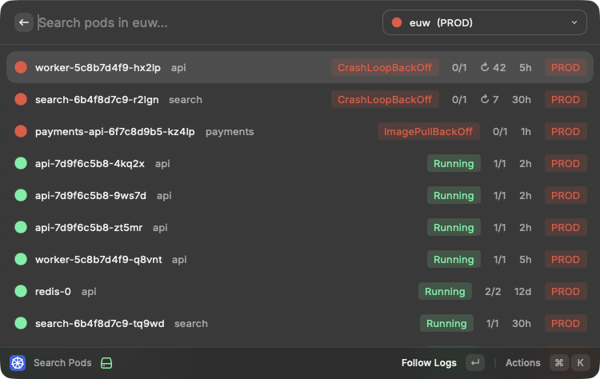
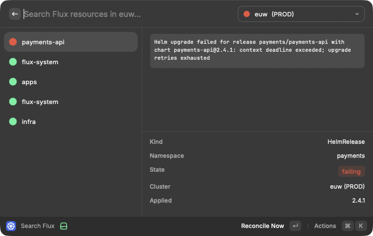
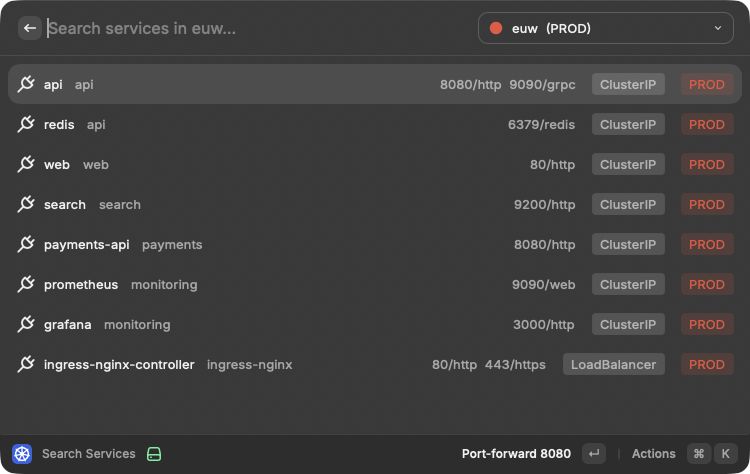
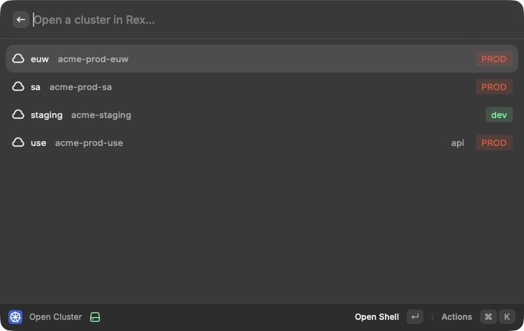
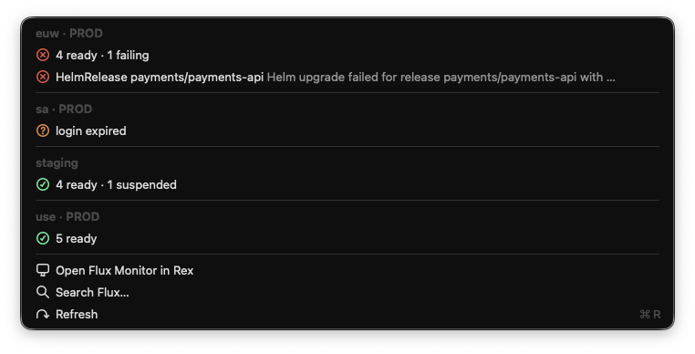
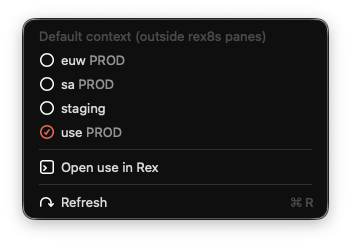

# Raycast

`raycast/` is a Raycast extension on top of `rex8s list` and the Rex actions.
It installs from a clone of this repository:

```sh
cd raycast && npm install && npm run dev   # imports it into Raycast
```

## Commands

- **Open Cluster** — open a shell or the ⇧⌘K layout — `kview` · shell · warnings (⌘L), optionally picking a
  namespace (⌘N).
- **Search Pods** — every pod of a cluster (crashing first): follow logs,
  explain with Claude (⌘E), talk to Claude about it (⌘⇧E, `kask`), shell into
  it (⌘S).
- **Search Services** — every service; port-forward on a free local port in
  the background (the browser opens for HTTP; kubectl connects on first use).
- **Search Workloads** — every workload of every cluster, with its version on
  each (orange when they differ): follow the logs of all its pods (on every
  cluster or one), search them (⌘G, a pattern), restart (⌘⇧R; production asks
  again in the tab).
- **Search Flux** — every Flux resource with its message; reconcile and wait
  for the result.

## Menu bars

- **Flux Status** — green when healthy, red with the number of failing
  resources.
- **Failing Pods** — the number of broken pods across every cluster (crash
  loops, image pulls, config errors; finished pods are left out), red when one
  is in production. Click a pod to open `kfail` on it in a Rex tab. A macOS
  notification when a pod newly breaks (once per workload; turn off with
  `notifications: false`).
- **Alerts** — firing alerts of every cluster (from the Alertmanager or
  Prometheus running in it), critical first, and a macOS notification when a
  critical one starts. Says so when a cluster's Prometheus has no alerting
  rules. Click: `kstatus` of that cluster in Rex.
- **Kube Context** — the machine's default context (`~/.kube/config`), red when
  it is production; click a cluster to switch (`rex8s use-context`). rex8s
  panes are not affected. Also lists the favorite forwards (click: open,
  starting it in the background when needed; a database's URL is copied
  instead) and the running ones: open, copy the URL or stop.

Clusters whose login expired offer "Log in" (runs `kauth` in a Rex tab).

## Rex tabs

Tabs opened from Raycast go to the Rex session named in the extension's
**Rex session** preference (default `k8s`, created when missing): Rex can't
tell which session the app is showing, so Raycast uses a known one and then
shows it.

To land on the new tab, turn on **Remote Control** in Rex (Settings → Rex
Server): it lets the extension ask the app to switch session and tab. Without
it the tab still opens, just in the background. (The ⇧⌘J/⇧⌘K picker doesn't
need it: that request starts in the app itself.)

## Screenshots

| Search Pods | Search Flux |
|---|---|
|  |  |
| **Search Services** | **Open Cluster** |
|  |  |

| **Flux Status** (menu bar) | **Kube Context** (menu bar) |
|---|---|
|  |  |
